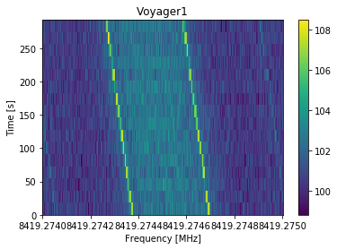

# Reading and plotting the Voyager 1 radio carrier

This notebook uses Breakthrough Listen radio data to show how the known Voyager 1 engineering carrier appears in a power spectrum and a time–frequency waterfall.

The waterfall uses **8419.2740–8419.2750 MHz** from the saved observing file. Its header records a start time of **19 September 2016 at 18:46:13 UTC**, **16 integrations** of **18.25 s** and a channel spacing of **2.794 Hz**. The carrier was known in advance and the plotted band was selected around it.

## Open the notebook and reproduce

1. Open [the observation notebook](Reading%20Voyager%20data%20and%20plotting.ipynb) to inspect the stored spectra, waterfall and file header.
2. Retrieve `Voyager1.single_coarse.fine_res.h5` from [the Breakthrough Listen public archive](https://seti.berkeley.edu/opendata/), place it beside the notebook and install `blimpy` and `matplotlib` to rerun it.
3. Run `python scripts/export_waterfall_preview.py` to regenerate this README image from the committed notebook output.

## Test the numerical diagnostics

Run `python research/narrowband_qa_20261118.py` for the self-contained [channel-excess and drift-track checks](research/NARROWBAND_QA_20261118.md). These tests use synthetic inputs. For a separate quantitative audit on the archived Voyager data, see [Voyager drift validation](https://github.com/Biswajit1999/technosignature-doppler-search/blob/main/docs/VOYAGER_DRIFT_VALIDATION.md).

Data credit: Breakthrough Listen / UC Berkeley SETI. Notebook and diagnostics: Biswajit Jana.
