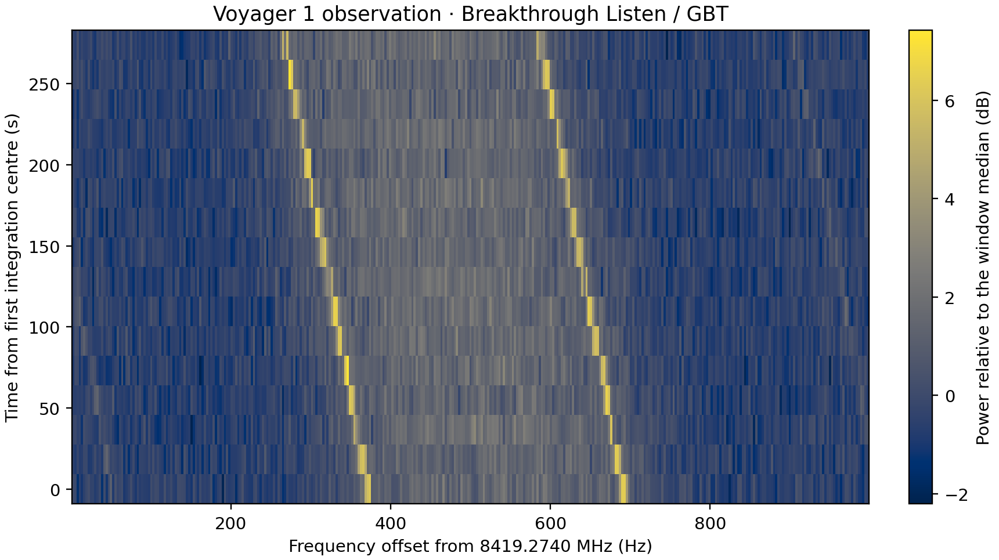

# Voyager 1 radio waterfall

Biswajit Jana

This example plots a 1 kHz window (8419.2740–8419.2750 MHz) in a public Green Bank Telescope filterbank recording labelled Voyager 1. The released HDF5 header and exact data bytes are checked before the replay.

## What the file contains

The file header records an observing start of 19 September 2016 at 18:46:13 UTC.

The window contains 16 integrations and 357 channel centres. The row cadence is 18.253611 s and the native channel spacing is about 2.794 Hz. Two visible ridges each move downward in frequency across the example. Straight-line fits to the peak bins in two chosen windows give about −0.38 Hz/s in both. These are descriptive, topocentric slopes. The power display is in decibels relative to the window median.



## Replay

[Open the replay notebook in Colab](https://colab.research.google.com/github/Biswajit1999/Reading-Voyager-Data-into-Python-and-Plotting/blob/main/Voyager_1_Waterfall_Replay.ipynb), or run:

```bash
python -m pip install numpy matplotlib h5py hdf5plugin
python research/replay_voyager.py --output voyager_output
```

The script downloads `Voyager1.single_coarse.fine_res.h5` (50,549,227 bytes) from the [Breakthrough Listen example archive](http://blpd0.ssl.berkeley.edu/Voyager_data/). If the archive’s HTTP route is unavailable, supply an existing copy with `--input /path/to/Voyager1.single_coarse.fine_res.h5`. The same SHA-256 check applies. The script writes a PNG and a JSON summary.

The [original exploratory notebook](Reading%20Voyager%20data%20and%20plotting.ipynb) shows the earlier Blimpy plots. Run `python scripts/export_waterfall_preview.py` to regenerate [the earlier preview](assets/voyager1-waterfall.png) from that notebook’s saved output. For a fit to the strongest carrier in a different window of this file, see the [Voyager drift validation](https://github.com/Biswajit1999/technosignature-doppler-search/blob/main/docs/VOYAGER_DRIFT_VALIDATION.md). The [separate narrowband QA exercise](research/NARROWBAND_QA_20261118.md) tests statistical mechanics on defined examples, with a different scope from the observed replay above.

Source data: Breakthrough Listen / Berkeley SETI Research Center and the Green Bank Telescope. [Open data archive](https://seti.berkeley.edu/opendata).
